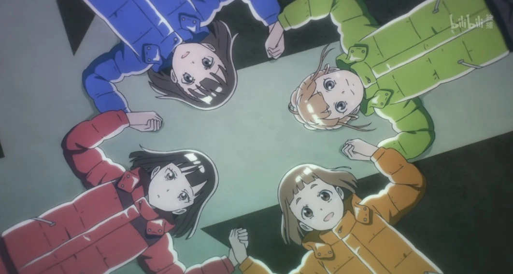
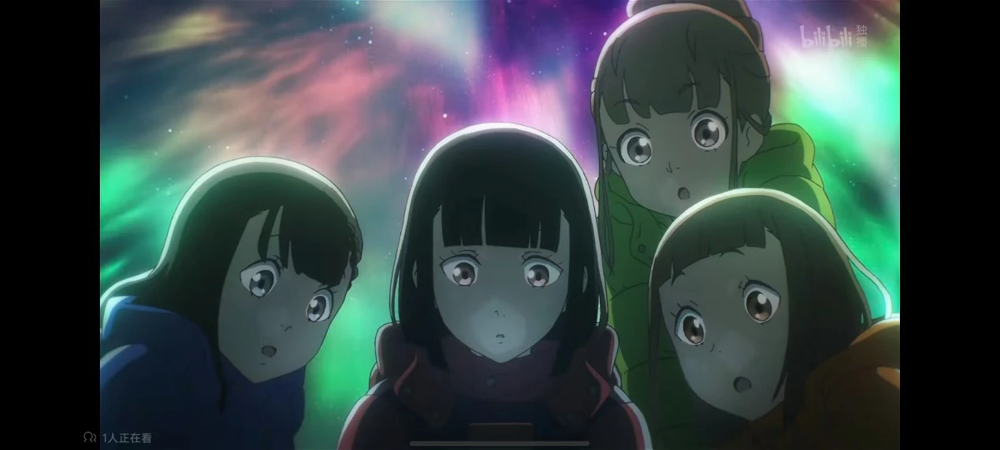

# 比宇宙更遥远的地方

比宇宙更遥远的地方，是哪里呢？我被这个名字吸引。

玉木真理，想要在高中留下难忘的经历，不浪费自己的青春，在看到报濑的努力后，决定走出对闺蜜的依赖，于是踏上了旅程；三宅日向，想在便利店的打工生活之外看见更广阔的世界，想要摆脱初中社团的痛苦回忆，想要去到那个赤裸的比宇宙还要远的地方；白石结月，要做记录下整个旅程的节目宣传，更多是为了能够和她们三人真正成为“朋友”，于是决定出发；小渊泽报濑，为追寻在科考中逝去的母亲，为探寻内心究竟是何种情感，为了到达那个地方，靠几年时间打工攒下一百万，误打误撞实现了自己的计划。

多亏了报濑，我实现了青春

乘上与平时相反方向的电车，为了去看未曾见过的风景。

还有好多好多印象很深刻的句子啊，关于什么是友谊，什么是青春……

小决不想虚度青春，下定决心踏上了旅行。也是，生活中不只有课程作业实验科研比赛，在地球的另一端还有这么多奇妙的景色与人。在30岁前，我也想去看看这个比宇宙更远的地方，亲眼看看那比照片美一百倍的极光与南极星。

白石结月一直想要追求友谊，可是世上并没有人知道友谊的定义。它不同于夫妻、母女，没有多么明确的标志。科考站的队员前辈说：互相之间能够放着不管，就是好朋友的标志。小决说：看着屏幕，有时出现已读的标志，有时回点什么，有时回的很快，有时回的稍晚一点，有时过了半天才有回复，但是自己能透过屏幕看到小惠的表情，知道她在上学、在睡觉，她想回信又不知道回点什么……之类。大概，友谊就是这种感觉吧。一起晕船的时候，一起看鲸鱼的清晨，初次踏上南极洲一起喊“该死”的时候，一起看着太阳光柱弹琴的时候，一起和企鹅拍照的时候，一起吃南极刨冰的时候，一起仰望极光的时候，我们早就成为了朋友吧。

报濑应该是番剧中笔墨最多的角色了，也因为她与南极的关系更加沉重。母亲于南极科考中失踪，自己因此下定决心攒钱一定要前往那个地方。期间有漠视同学的嘲笑，有与母亲旧友兼队长的和解，也因为一直不清楚自己心中的情感究竟是什么样的，害怕到了那个“终点”后，自己以后会一直沉溺于这种情感之中。。。但最终，她还是走到了母亲生前失踪的天文台。在翻到母亲的电脑，看到自己几年来日日写的信件一封封跳进收件箱的时候，终于放声痛哭。都说亲人的离世是一生的潮湿，或许就是这样的情感吧。母亲最后的遗书是发给女儿的邮件，是她生命最后看到的风景，告诉她：真正的极光，比照片里好看一万倍。愿母亲在南极永伴极光。

没有云 也没有鸟的踪影 放眼望去一片碧蓝 无论怎么凝目远眺 能看到的都只有一望无际的水平线 本应能听到船发出的声响 然而这令人震惊的景色使得声音消失不见了 在那里的 是犹如宇宙一般的寂静的世界 那个时候我们确信了 原来南极 真的存在于海的对岸

很喜欢op的末尾，“天高地阔不断蔓延，我的青春远在天边，近在眼前”。年少气盛的我们有着许多看似不切实际的梦想与目标，它们亦毫无疑问是我们内心最为真实的追求与渴望。然而因为“理性”的束缚以及“实际”的考量，那些最初的梦想也仅仅停留在“豪言壮语”的阶段。随着时间的推移以及一成不变的“流水账式”生活，曾经充满“雄心壮志”的内心早已被被社会和现实磨平了棱角。此时甘于平凡的我们不禁扪心自问：如果当时能迈出决定性的一步，那些遥不可及的理想，是否会离我们更近一些呢...

最后抄写几句最后一集很喜欢的句子吧

当你无法回头时，才是真正的旅行。

我的母亲是南极观测队员，她很喜欢南极，看到沉迷南极不顾家庭的母亲，说真的，我对南极没什么好印象。我想整理一下自己的这种感情，于是有了来到这里的想法。比宇宙更远的地方，母亲是这样形容南极的。这里的一切都是赤裸裸的，时间也好，生物也好，心灵也好，是没有保护，没有藏身之处的地方。我们身在其中，将自己羞耻的一面、想隐瞒的一面全部展现出来，一边哭泣，一边赤裸裸地直面自身，一起跨越了一个又一个难关。然后我觉得我明白了，母亲爱的不仅仅是这里的景色这里的天空这里的风，也同样爱着与同伴一起渡过难关的这段时光。她非常喜欢没有任何阻碍，只能和同伴一起渡过的这片空间。我一定会再回来的，回到这里！

有些事，我通过旅行才第一次知晓，这幕景色是无可替代的，就算自己没有在看，人和世界也都在不断发生变化，什么都不发生的一天是根本不存在的，自己的家是有味道的，迈出脚步，去了解这些吧，在看到陌生的景色之前，一直走下去吧，因为无论走到哪里，世界都很广阔，一定能发现些新的事物，虽然有点害怕，但一定能做到，因为有着同样想法的人，立刻就会察觉到。

踏上旅途吧，因为世界如此广阔！终有一天我会回到这里，回到比宇宙更远的地方！

## ハルカトオク（遥远）

  そっと記した夢
  so't to shi ru shi ta yu me
  悄悄将梦想铭记于心

  言い訳ばかりして
  i i wa ke ba ka ri shi te
  满嘴都是借口

  ほったらかしにしていた
  ho't ta ra ka shi ni shi te ita
  对一切置之不理

  変わるのが怖くて
  ka wa ru no ga ko wa ku te
  我不害怕改变

  何があるのかも
  na ni ga a ru no ka mo
  或许还会留下些什么

  何が変わるのかも
  na ni ga ka wa ru no ka mo
  或许还会改变些什么

  行ってみなきゃわからない
  i't te mi na kya wa ka ra na i
  不前进的话便一无所知

  さあ一歩前に
  sa a i'p po ma e ni
  来吧

  踏み出そう
  fu mi da so u
  向前迈出一步

  おっきな夢を叶えたくて
  o'k ki na yu me o ka na e ta ku te
  愿实现巨大的梦想

  はるか遠く遠く
  ha ru ka to o ku to o ku
  而它却如此遥远

  真っ白な世界に残したいな
  ma's shi ro na se ka i ni no ko shi ta i na
  我好想将最初的足迹

  最初の足跡
  sa i sho no a shi a to
  留在这纯白的世界

  世界の最果てで
  se ka i no sa i ha te de
  在世界的尽头

  転がっていく太陽
  ko ro ga't te i ku ta i yo u
  太阳渐渐升起

  南風はやがて島を越えて
  mi na mi ka ze wa ya ga te shi ma o ko e te
  南风最终吹过小岛

  髪を揺らす
  ka mi o yu ra su
  吹动着我的头发

  ちっさな夢を叶えたくて
  chi's sa na yu me o ka na e ta ku te
  愿实现渺小的梦想

  願った強く強く
  ne ga't ta tsuyoku tsuyoku
  愿望如此强烈

  履き慣れたスニーカー
  ha ki na re ta su ni i ka a
  穿习惯的运动鞋

  紐をキュッと締め直して
  hi mo o kyu't to shi me na o shi te
  将鞋带重新系紧

  でっかい夢を叶えたくて
  de'k ka i yu me o ka na e ta ku te
  愿实现巨大的梦想

  はるか遠く遠く
  ha ru ka to o ku to o ku
  而它却如此遥远

  波に揺られてかたふりして
  na mi ni yu ra re te ka ta fu ri shi te
  随着波浪摇摆

  進んでゆくよ
  su su n de yu ku yo

  宇宙より遠くへ
  so ra yo ri to o ku he
  向着比宇宙更远的地方前进

