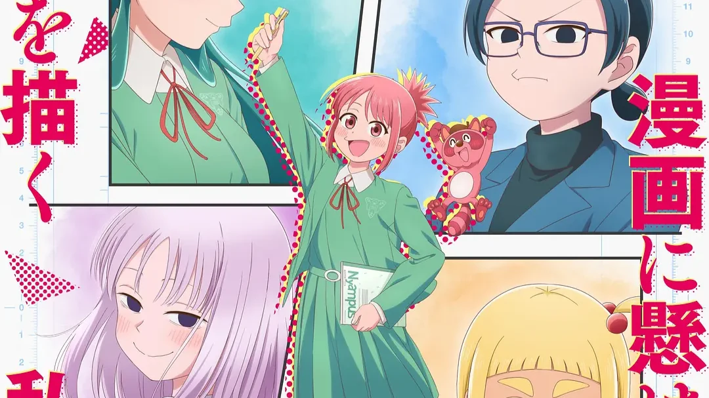
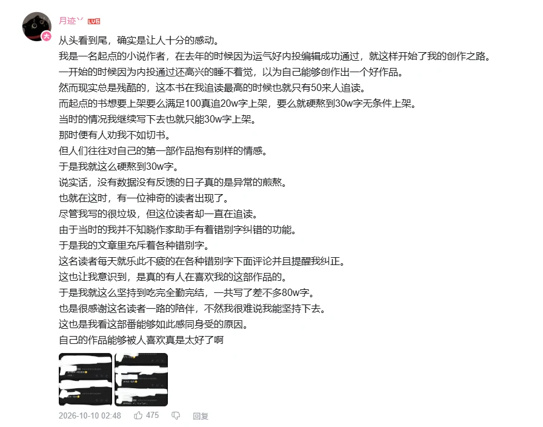

# 描绘直至生命尽头

7月看的最舒服最喜欢的一部番

故事分为两条线进行叙述，一面为女主安海从一部漫画开始走出孤独，组建漫画研不断绘画不断进步的故事；另一面为老师手岛0的过去叙事。小0在追逐漫画的过程中，无数次绝望无数次迷茫无数次欢喜，因漫画产生了许许多多奇妙的缘分，看到众生百态，又在不经意间因机器猫与狸猫这部作品感染了安海走出孤独走上画漫画的这条路。安海从老师的经历中得到许多成长，又也在不经意间让已然成为老师的小0 重拾漫画，与过去和解，看到了不同于自己的另一条漫画路。

自己通过作品定格住某个瞬间迸发出灵感，又借由作品进入到另一个人的生命，某一天，那份曾经送出去的东西，又借对方之手回来托住自己。

画漫画固然是痛苦的，但发表后的喜悦又是无可替代的。曾经画出的作品，又可能在无数个时间后稍稍感染到心意相通的另一个人。

7月的好多作品，都看到了真实之爱啊。。。

